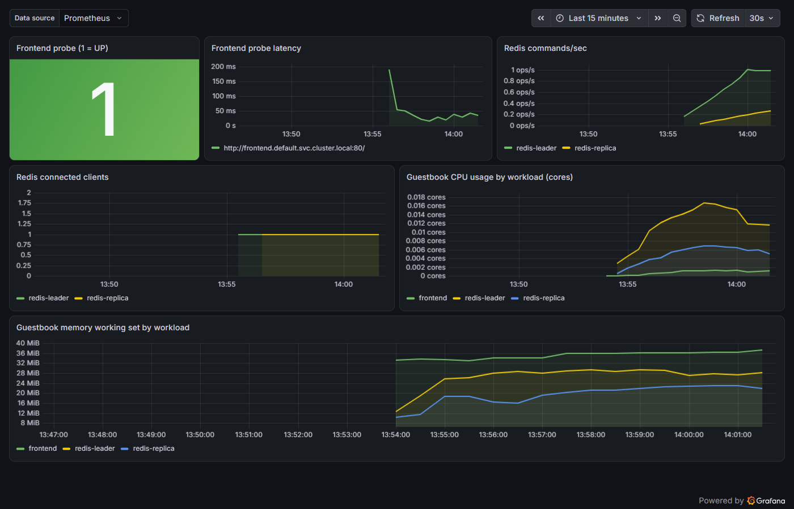
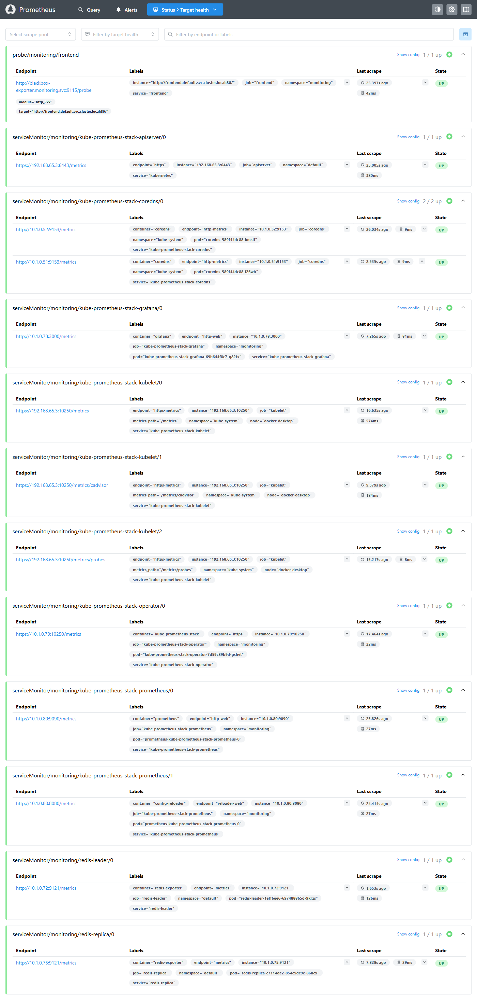

# Guestbook on Kubernetes, with Prometheus and Grafana monitoring (Pulumi, TypeScript)

The Kubernetes Guestbook (a Redis leader, a Redis replica and three PHP frontends), extended with a
monitoring stack. **Everything is deployed by one Pulumi program:** one `pulumi up` builds the app,
Prometheus, Grafana and a Guestbook dashboard, and outputs Grafana's URL and admin credentials.

Derived from the `kubernetes-ts-guestbook` (simple variant) example in
[pulumi/examples](https://github.com/pulumi/examples), licensed under Apache-2.0 (see `LICENSE` and
`NOTICE`). The Guestbook application originates from the
[Kubernetes tutorial](https://kubernetes.io/docs/tutorials/stateless-application/guestbook/).



## What gets deployed

| Namespace | Component | Details |
|---|---|---|
| `default` | `frontend` x3 | `pulumi/guestbook-php-redis` (Apache/PHP), Service on port 80 (LoadBalancer by default) |
| `default` | `redis-leader` | `redis:7` + **redis_exporter v1.96.0 sidecar** on port 9121, named `metrics` |
| `default` | `redis-replica` | `pulumi/guestbook-redis-replica` + **redis_exporter sidecar** on port 9121, named `metrics` |
| `monitoring` | kube-prometheus-stack **92.16.1** (Helm) | Prometheus (+ operator) and Grafana (NodePort **32000**) |
| `monitoring` | prometheus-blackbox-exporter **11.20.2** (Helm) | probes the frontend over HTTP (port 9115) |
| `monitoring` | 2 ServiceMonitors, 1 Probe | scrape config for the Redis exporters and the frontend probe |
| `monitoring` | ConfigMap `guestbook-dashboard` | the Grafana dashboard, picked up by Grafana's dashboard sidecar |

Files: `index.ts` (the app and outputs), `monitoring.ts` (the monitoring stack), `dashboard.ts` (the
dashboard), `Pulumi.yaml` (config schema). This README is also available as `README.html` (same
content, for reading in a browser).

## Prerequisites

Tested on Windows 11 with PowerShell, Docker Desktop (WSL 2) and its built-in Kubernetes v1.36.

- Node.js 24, Git, kubectl, and the [Pulumi CLI](https://www.pulumi.com/docs/get-started/install/)
  (`winget install --id Pulumi.Pulumi -e`). The Helm CLI is **not** needed: Pulumi renders the charts.
- Docker Desktop &rarr; Settings &rarr; Kubernetes &rarr; **Enable Kubernetes**, cluster type **kubeadm**
  (in the *kind* mode NodePorts do not reach `localhost`).
- Enough memory for the VM. On an 8 GB PC, set it in `%USERPROFILE%\.wslconfig`, then quit Docker
  Desktop, run `wsl --shutdown` and start it again:

  ```ini
  [wsl2]
  memory=4GB
  swap=4GB

  [experimental]
  autoMemoryReclaim=gradual
  ```

## Deploy

Start Docker Desktop first and wait until its status bar shows **Kubernetes running** (green); then
`kubectl get nodes` should list `docker-desktop   Ready`.

The repository deliberately ships **no `Pulumi.dev.yaml`**: that file holds a stack's config and an
encryption salt tied to its creator's passphrase, so a copied one makes `pulumi stack init` fail with
`incorrect passphrase`. The `pulumi config set` lines below create your own.

```powershell
kubectl config use-context docker-desktop
npm install

# Pulumi state stays on this machine (no Pulumi Cloud account needed).
# Secrets in the stack are encrypted with this passphrase: set it in every new PowerShell window.
$env:PULUMI_CONFIG_PASSPHRASE = "choose-a-passphrase"
pulumi login --local
pulumi stack init dev

pulumi config set serviceType LoadBalancer      # frontend: LoadBalancer (default) or NodePort
pulumi config set grafanaServiceType NodePort   # Grafana: NodePort (default) or LoadBalancer
pulumi config set grafanaNodePort 32000

npx tsc --noEmit        # compile check
pulumi up --yes         # about 3 minutes on a laptop once images are cached
pulumi up --refresh --yes   # reads the LoadBalancer address into frontendUrl
```

| Config key | Default | Meaning |
|---|---|---|
| `serviceType` | `LoadBalancer` | Frontend Service type (`LoadBalancer` or `NodePort`) |
| `frontendNodePort` | `30080` | Frontend NodePort when `serviceType` is `NodePort` |
| `grafanaServiceType` | `NodePort` | Grafana Service type (`NodePort` or `LoadBalancer`) |
| `grafanaNodePort` | `32000` | Grafana NodePort |
| `grafanaHost` | `localhost` | Host used to build the `grafanaUrl` output |

The Guestbook is then at `pulumi stack output frontendUrl` (`http://localhost`).

## Grafana access

The **source of truth is the stack output**: every fresh deployment generates a new admin password.

```powershell
pulumi stack output grafanaUrl                           # http://localhost:32000
pulumi stack output grafanaAdminUser                     # admin
pulumi stack output grafanaAdminPassword --show-secrets  # generated password
```

Log in at `http://localhost:32000` as `admin` with that password. No password is written in this
repository: each deployment generates its own, and only the stack output knows it. The dashboard is
at `http://localhost:32000/d/guestbook` (Dashboards &rarr; **Guestbook**, in the General folder).

Verified path: **NodePort 32000** on Docker Desktop (kubeadm). Grafana is a NodePort by default
because the frontend's LoadBalancer already owns `localhost:80`, and a fixed NodePort gives a
deterministic URL. If it does not open: `kubectl -n monitoring port-forward svc/kube-prometheus-stack-grafana 3000:3000`
and browse `http://localhost:3000`.

The password is created by Pulumi (`random.RandomPassword`), stored in a Kubernetes Secret and given
to Grafana through `grafana.admin.existingSecret`, so it never appears in the Helm release values.

## Verify that Prometheus scrapes the Guestbook

**How each tier is monitored:** the **backend is scraped**: a redis_exporter sidecar in each Redis
pod publishes `/metrics`, and two ServiceMonitors point Prometheus at it. The **frontend is probed,
not scraped**: its Apache/PHP image exposes no metrics endpoint, so blackbox-exporter requests the
page every 30 s and records availability and latency. CPU and memory for every Guestbook pod come
from the kubelet's cAdvisor endpoint.

```powershell
kubectl -n monitoring port-forward svc/kube-prometheus-stack-prometheus 9090:9090
```

Open `http://localhost:9090/targets`. Expected (the acceptance test):

| Target | State | Proves |
|---|---|---|
| `serviceMonitor/monitoring/redis-leader/0` | UP | backend scraped |
| `serviceMonitor/monitoring/redis-replica/0` | UP | backend scraped |
| `probe/monitoring/frontend` | UP | frontend probed |
| `serviceMonitor/monitoring/kube-prometheus-stack-kubelet/1` (`/metrics/cadvisor`) | UP | pod CPU/memory |



Query checks (PowerShell, with the port-forward running):

```powershell
function Get-PromQL($q) {
  (Invoke-RestMethod -Method Post -Uri http://localhost:9090/api/v1/query -Body @{ query = $q }).data.result |
    ForEach-Object { "{0} = {1}" -f ($_.metric | ConvertTo-Json -Compress), $_.value[1] }
}
Get-PromQL 'up{job=~"redis-.*"}'                     # 2 series, both 1
Get-PromQL 'redis_up'                                # 2 series, both 1
Get-PromQL 'probe_success{job="frontend"}'           # 1
Get-PromQL 'probe_http_status_code{job="frontend"}'  # 200
```

End-to-end proof (traffic in, metrics out):

```powershell
$frontendUrl = pulumi stack output frontendUrl
1..50 | ForEach-Object { Invoke-WebRequest $frontendUrl -UseBasicParsing | Out-Null }
Get-PromQL 'sum(rate(redis_commands_processed_total[2m]))'   # > 0, rises with the traffic
```

In the reference run, 50 requests moved `redis_commands_processed_total` from 202 to 238.

## The dashboard

Grafana &rarr; Dashboards &rarr; **Guestbook** (provisioned from `dashboard.ts`, in the General folder).

| Panel | Query | Healthy |
|---|---|---|
| Frontend probe (1 = UP) | `probe_success{job="frontend"}` | green `1` (a down frontend shows red `0`; *No data* means the probe target is missing) |
| Frontend probe latency | `probe_duration_seconds{job="frontend"}` | tens of ms |
| Redis commands/sec | `sum by (job) (rate(redis_commands_processed_total[5m]))` | rises with traffic |
| Redis connected clients | `sum by (job) (redis_connected_clients)` | 1 per instance between requests (PHP connects per request) |
| CPU by workload | pod-level `container_cpu_usage_seconds_total`, grouped by workload | small, steady |
| Memory by workload | pod-level `container_memory_working_set_bytes`, grouped by workload | about 20-40 MiB each |

## Design decisions

- **Frontend probed, not scraped.** The image has no `/metrics` and no `mod_status`; adding them
  means rebuilding the image. A blackbox Probe gives honest availability and latency without that.
- **redis_exporter as sidecars** rather than a separate Deployment: it reads Redis over `localhost`
  in the same pod. It has a **liveness** probe, deliberately not a readiness probe: a failing
  readiness probe would mark the Redis pod NotReady and pull Redis out of its Service, letting a
  monitoring sidecar break the app.
- **Explicit labels, namespaces and named ports.** In the stock example the Services' labels resolve
  to `undefined` and nothing sets a namespace, so a ServiceMonitor would silently match nothing.
  Every app resource now has `namespace: default`, an `app` label and named ports (`metrics`, `redis`,
  `http`); the ServiceMonitors select them across namespaces with `namespaceSelector`.
- **Selector flags.** `serviceMonitorSelectorNilUsesHelmValues` and `probeSelectorNilUsesHelmValues`
  are `false`, so Prometheus discovers our ServiceMonitors and Probe without the chart's `release`
  label. Left at the default, a miss is silent.
- **Sized for an 8 GB laptop.** Alertmanager, **node-exporter and kube-state-metrics are disabled**:
  none is required here, pod CPU/memory comes from the kubelet's cAdvisor endpoint, and
  node-exporter crash-loops on Docker Desktop ("path / is mounted on / but it is not a shared or
  slave mount"). The chart's default `node_*`/`kube_*` recording rules therefore evaluate empty,
  which is harmless because no alerts are configured. Control-plane scrapers that Docker Desktop
  does not expose are off. Limits: Prometheus 768Mi, Grafana 512Mi; no persistent volumes.
- **Pod-level resource queries.** Docker Desktop's container runtime exposes only pod-level cAdvisor
  series (no `container` label), so the CPU/memory panels use pod-level series (`container=""`),
  which exist on every runtime, grouped into a `workload` label derived from the pod name. Per-pod
  figures include the exporter sidecar.
- **`isMinikube` replaced** by `serviceType` (frontend) and `grafanaServiceType` (Grafana).
- **Pinned versions:** both charts, redis_exporter, `redis:7` and the npm packages. The two
  `pulumi/guestbook-*` images publish no version tags, so they cannot be pinned.

## Starting it again (after a reboot or quitting Docker)

The deployment lives inside Docker Desktop's Kubernetes, so it comes back on its own when Docker
starts. Nothing needs redeploying.

```powershell
# 1. Start Docker Desktop, wait for "Kubernetes running", then:
kubectl get nodes                         # docker-desktop   Ready
kubectl get pods -n default               # 3 frontend 1/1, redis-leader 2/2, redis-replica 2/2
kubectl get pods -n monitoring            # all Running (Grafana 3/3, Prometheus 2/2)

# 2. Only if the pods are missing (e.g. Kubernetes was reset), in this folder:
$env:PULUMI_CONFIG_PASSPHRASE = "your-passphrase"
pulumi up --yes
```

Then browse `http://localhost` (Guestbook) and `http://localhost:32000` (Grafana). Pods can take a
minute or two to turn Running after Kubernetes reports Ready.

## Troubleshooting

These were all hit while testing this README from scratch (fresh copy of the repository, empty
cluster, new passphrase) on Nov 3, 2026.

| Symptom | Cause | Fix |
|---|---|---|
| `pulumi stack init dev` fails: `could not create secrets manager for new stack: incorrect passphrase` | A `Pulumi.dev.yaml` from another person's stack is in the folder; its encryption salt belongs to their passphrase | Delete `Pulumi.dev.yaml` (it is not shipped in this repository) and run `pulumi stack init dev` again |
| `pulumi stack init dev` fails: stack already exists | You already have a local stack called `dev` in `~/.pulumi` | Use another name (`pulumi stack init guestbook-test`) or `pulumi stack select dev` |
| Docker Desktop closes itself a few seconds after starting (backend log ends with `shutting down vital services`) | Stale socket files left in `%LOCALAPPDATA%\Docker\run` and `%LOCALAPPDATA%\docker-secrets-engine` (seen on a PC with McAfee; `docker desktop stop` does not remove them) | Quit Docker, then rename both folders aside and start Docker again (commands below). An antivirus exclusion for those folders is the permanent fix |
| `kubectl exec` fails: `server gave HTTP response to HTTPS client` | Docker Desktop's cri-dockerd runtime | Not needed by this README; use the port-forward or the Grafana UI instead |
| Grafana panels show *No data* right after deploying | Prometheus has not scraped yet | Wait a minute and set the time range to *Last 15 minutes* |

```powershell
# Docker Desktop startup fix (stale sockets): quit Docker Desktop first.
$ts = Get-Date -f yyyyMMddHHmm
Rename-Item "$env:LOCALAPPDATA\Docker\run" "run.old-$ts" -ErrorAction SilentlyContinue
Rename-Item "$env:LOCALAPPDATA\docker-secrets-engine" "docker-secrets-engine.old-$ts" -ErrorAction SilentlyContinue
Start-Process "C:\Program Files\Docker\Docker\Docker Desktop.exe"
```

## Teardown

```powershell
pulumi destroy --yes
pulumi stack rm dev
```

Helm never deletes a chart's CRDs. To remove the leftover Prometheus operator CRDs:

```powershell
kubectl get crd -o name | Select-String 'monitoring.coreos.com' | ForEach-Object { kubectl delete $_.ToString().Trim() }
```

## Other clusters

- **kind** (not Docker Desktop): NodePorts and LoadBalancers do not reach `localhost`, so use
  `kubectl port-forward svc/frontend 8080:80` and
  `kubectl -n monitoring port-forward svc/kube-prometheus-stack-grafana 3000:3000`.
- **Cloud clusters:** `pulumi config set grafanaServiceType LoadBalancer`; run `pulumi up --refresh`
  once more after the first deploy so `grafanaUrl` picks up the load balancer address.

## Limitations and next steps

No alerting rules are defined; Prometheus is a single replica; metrics are lost when its pod
restarts (no persistent volume); Prometheus itself has no authentication. Natural next steps:
SLO-based alerts on probe success and Redis availability, persistent storage, and an Apache
exporter if the frontend image can be rebuilt.
